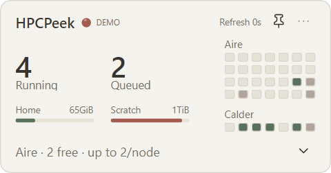
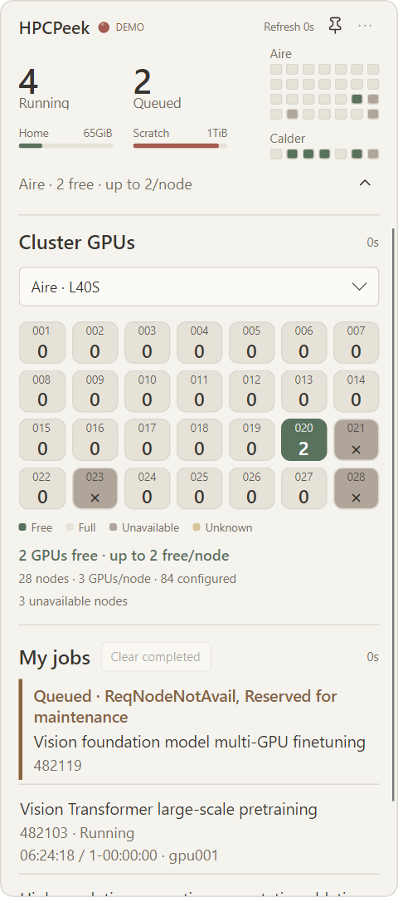

# HPCPeek

A quiet floating window for University of Leeds HPC jobs, GPU availability and storage quotas. Keep it beside your IDE or paper, then expand when you need the details.

## Download

Open **Releases -> Assets** and download the ZIP for your computer. Extract the **whole archive**, then open `HPCPeek.exe` on Windows or `HPCPeek.app` on macOS.

| Platform | Package example (v1.1.0) |
| --- | --- |
| Windows 11 x64 | `HPCPeek-v1.1.0-win-x64-portable.zip` |
| macOS 15+ · Apple Silicon | `HPCPeek-v1.1.0-osx-arm64-portable.zip` |
| macOS 15+ · Intel | `HPCPeek-v1.1.0-osx-x64-portable.zip` |

The runtime is included. No separate .NET, Python, OpenSSH or MobaXterm installation is needed. Keep the application and its bundled files together; on Windows, use a folder you can write to.

Mac builds without Developer ID signing and notarization have **`-unsigned-test`** in the filename. They are test builds, not Gatekeeper-approved releases. Check the release notes for platform validation and compare your download with `SHA256SUMS.txt`. GitHub's automatic **Source code** archives are not runnable packages.

**Upgrading:** quit the old app first. On Windows, copy its `portable-data` folder into the new extracted folder to keep connection settings and trusted fingerprints. On Mac, settings remain in Application Support. Remembered passwords stay in this computer's system credential store; copying the app to another computer does not transfer them.

## Connect

1. Choose **Aire** or **Calder**, enter your university username and select **Direct** or **SSH gateway**. The default hosts are `aire.leeds.ac.uk` / `calder.leeds.ac.uk`, with `rash.leeds.ac.uk` as the gateway; all use port 22 and remain editable.
2. Use Direct on a permitted campus network or university VPN. If you already have a working MobaXterm session, **From MobaXterm** explains where to find its connection settings.
3. Verify each new host's SHA-256 fingerprint through a trusted university source, then follow the server's password and Duo prompts.

Successful sign-in returns to the compact window. Connect the other cluster when needed; both sessions can stay open independently. Saved connection fields can be edited without restarting the app. Refreshing or opening details reuses the authenticated connection.

## Read the panel

The compact panel is 320 × 168 logical pixels, with space between job counts, quotas and the footer on the left, and both GPU matrices on the right.

- **Running / Queued** counts cover the sampled clusters. The connection dot and GPU summary refer to the selected cluster; hover for account and sample details.
- **Home / Scratch** horizontal bars sit directly below Running and Queued respectively, with each directory label and total quota above its bar. They show the selected account directory's used space against its quota: green below 75%, amber from 75% to below 90%, and red from 90%. Hover for the directory, used/total space, percentage, quota scope and sample age. Home and Aire Scratch use user quotas; Calder Scratch can use a shared project quota. An unavailable quota stays unknown; the app never substitutes the capacity of the whole filesystem.
- **One square, one node.** The Calder GPU matrix sits below Aire, each with its cluster name at the top left. Select a cluster name to switch the selected cluster. Green means at least one whole GPU is free. Expand for the exact remaining number; full, unavailable and unknown nodes stay distinct. `Configured` is installed capacity, not current availability.
- **My jobs** shows queue reasons, copyable job IDs, elapsed time, limits and nodes. Expanded running jobs have a locally updated elapsed estimate. **Clear completed** removes confirmed finished jobs from the selected cluster's local history, including failed, cancelled and timed-out jobs. Running, queued and unconfirmed jobs stay visible. It does not cancel jobs or delete server records or files. Completion notices wait for Slurm confirmation.
- **Refresh 12s** in the header means 12 seconds since the selected cluster last returned a successful jobs, GPU or storage sample. Hover to inspect the separate source ages and errors; one successful source does not make another source's data current. The three-dot menu uses **Refresh** for a manual update. Automatic refresh defaults to five minutes; Settings offers 15, 30 or 60 minutes and a custom interval. After a disconnect, the last snapshot remains dated; choose **Reconnect** to authenticate again.

Drag the header to move the window, pin it to keep it visible, or hide it in the tray/menu bar. Hiding keeps monitoring active; **Quit HPCPeek** closes the app's own connections.

Expanded view

Screenshots use offline Demo data. Free GPUs do not guarantee an immediate start: reservations, priority, CPU and memory also matter.

## Passwords and privacy

**This connection** is the default: no password is saved. Choose **Remember on this device** to store an ordinary password in your current user's **Windows Credential Manager** or **macOS Keychain**, scoped to the host, port and username. Passwords are never written to portable settings, exported preferences or application logs. Use **Settings → Connection → Forget saved passwords** to remove saved entries.

**Use one password for both hosts** is a separate, optional convenience for matching gateway and cluster passwords. **Duo approvals, SMS codes and other one-time answers are never saved or shared.** Remembering a password cannot bypass the university's authentication requirements. A changed host fingerprint stops the connection.

HPCPeek runs read-only Slurm and storage-quota queries; it does not submit or cancel jobs, delete files, or recursively scan your directories. There is no telemetry or cloud credential sync. Connection settings, usernames and trusted host fingerprints are stored locally, separately from saved passwords. Keep your `portable-data` folder private when sharing a Windows installation; on macOS, settings are stored in `~/Library/Application Support/HPCPeek`.

## Contributing & Feedback

This is an independent software, contributions, issues, and feature requests are welcome! Thank you for making this project better!

Build and publishing instructions, including a Chinese step-by-step GitHub update and Release guide, are in [Build and release HPCPeek](docs/BUILD-CROSSPLATFORM.md).

If an earlier v1.1.0 download shows `—` for both storage quotas after sign-in, install the quota hotfix from the same Release once its assets have been replaced. Check the updated `SHA256SUMS.txt`, extract into a new folder, then copy `portable-data` with the app closed. Keeping the same version number does not update an existing installation automatically. The [v1.1.0 replacement guide](docs/BUILD-CROSSPLATFORM.md#中文保留-v110-替换配额修复包) explains the publisher's steps.
