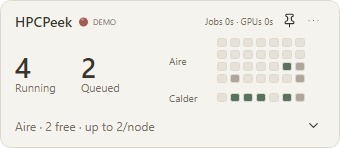
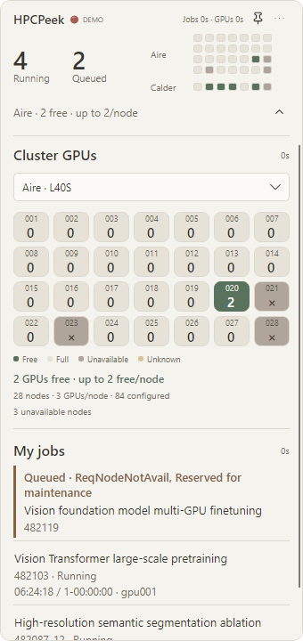

# HPCPeek

A quiet desktop window for your University of Leeds **Aire and Calder** jobs and GPU availability. Keep it beside your editor or paper, then expand when you need the details.



## Download

Open **Releases → Assets** and download the ZIP for your computer. Extract the **whole archive**, then open `HPCPeek.exe` on Windows or `HPCPeek.app` on macOS.

| Platform | v1.0.0 package |
| --- | --- |
| Windows 11 x64 | `HPCPeek-v1.0.0-win-x64-portable.zip` |
| macOS 15+ · Apple Silicon | `HPCPeek-v1.0.0-osx-arm64-portable.zip` |
| macOS 15+ · Intel | `HPCPeek-v1.0.0-osx-x64-portable.zip` |

The runtime is included. No separate .NET, Python, OpenSSH or MobaXterm installation is needed. Keep the application and its bundled files together; on Windows, use a folder you can write to.

Mac builds without Developer ID signing and notarization have **`-unsigned-test`** in the filename. They are test builds, not Gatekeeper-approved releases. Check the release notes for platform validation and compare your download with `SHA256SUMS.txt`. GitHub's automatic **Source code** archives are not runnable packages.

**Upgrading:** quit the old app first. On Windows, copy its `portable-data` folder into the new extracted folder to keep connection settings and trusted fingerprints. On Mac, settings remain in Application Support. Remembered passwords stay in this computer's system credential store; copying the app to another computer does not transfer them.

## Connect

1. Choose **Aire** or **Calder**, enter your university username and select **Direct** or **SSH gateway**. The default hosts are `aire.leeds.ac.uk` / `calder.leeds.ac.uk`, with `rash.leeds.ac.uk` as the gateway; all use port 22 and remain editable.
2. Use Direct on a permitted campus network or university VPN. If you already have a working MobaXterm session, **From MobaXterm** explains where to find its connection settings.
3. Verify each new host's SHA-256 fingerprint through a trusted university source, then follow the server's password and Duo prompts.

Successful sign-in returns to the compact window. Connect the other cluster when needed; both sessions can stay open independently. Saved connection fields can be edited without restarting the app. Refreshing or opening details reuses the authenticated connection.

## Read the panel

- **Running / Queued** counts cover the sampled clusters. The connection dot and GPU summary refer to the selected cluster; hover for account and sample details.
- **One square, one node.** Green means at least one whole GPU is free. Expand for the exact remaining number; full, unavailable and unknown nodes stay distinct. `Configured` is installed capacity, not current availability.
- **My jobs** shows queue reasons, copyable job IDs, elapsed time, limits and nodes. Expanded running jobs have a locally updated elapsed estimate. Completion notices wait for Slurm confirmation.
- **Refresh** defaults to five minutes. Settings offers 15, 30 or 60 minutes and a custom interval. After a disconnect, the last snapshot remains dated; choose **Reconnect** to authenticate again.

Drag the header to move the window, pin it to keep it visible, or hide it in the tray/menu bar. Hiding keeps monitoring active; **Quit HPCPeek** closes the app's own connections.

<details>
<summary>Expanded view</summary>



Screenshots use offline Demo data. Free GPUs do not guarantee an immediate start: reservations, priority, CPU and memory also matter.

</details>

## Passwords and privacy

**This connection** is the default: no password is saved. Choose **Remember on this device** to store an ordinary password in your current user's **Windows Credential Manager** or **macOS Keychain**, scoped to the host, port and username. Passwords are never written to portable settings, exported preferences or application logs. Use **Settings → Connection → Forget saved passwords** to remove saved entries.

**Use one password for both hosts** is a separate, optional convenience for matching gateway and cluster passwords. **Duo approvals, SMS codes and other one-time answers are never saved or shared.** Remembering a password cannot bypass the university's authentication requirements. A changed host fingerprint stops the connection.

HPCPeek runs read-only Slurm queries; it does not submit or cancel jobs. There is no telemetry or cloud credential sync. [Security details](docs/SECURITY.md) · [中文快速上手](docs/QUICKSTART.zh-CN.md)

## Memory use

For reference, **about 45 MiB of private resident memory** was measured on Windows 11 x64 with the compact offline Demo. Three fresh processes were sampled for 30 seconds each; the median of their final ten-second averages was **44.83 MiB before / 44.76 MiB after** the v1.0.0 optimization. This is effectively unchanged within normal variation, not a meaningful RAM reduction.

The update reduces repeated GPU-summary calculations and status binding work. A connected session around **63 MB should still be expected to stay in that general range**, not drop dramatically; authentication, job count, open details and graphics drivers affect usage. This is a rough expectation, not a memory limit. Total working set and committed memory are different, larger counters. macOS memory use has not been measured locally.

<details>
<summary>Build from source</summary>

Install .NET 10 SDK and PowerShell 7, then run:

```powershell
./scripts/test.ps1
dotnet run --project ./src/AirePeek.Desktop -- --demo
./scripts/build-portable.ps1 -Version 1.0.0 -AllPlatforms
```

The source checkout includes `docs/BUILD-CROSSPLATFORM.md` and `docs/GITHUB-RELEASES.md` for build, signing and publication instructions. Source folders and namespaces retain the original `AirePeek` name; the shipped app is **HPCPeek**.

</details>

Independent software; not affiliated with or endorsed by the University of Leeds or Slurm. [Third-party notices](docs/THIRD-PARTY-NOTICES.md)
